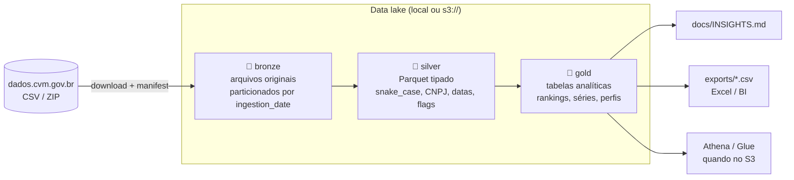

# CVM DataHub: pipeline medallion de dados abertos da CVM

Pipeline de engenharia de dados que coleta os dados abertos da
[Comissão de Valores Mobiliários](https://dados.cvm.gov.br) e os organiza num data lake em
**arquitetura medallion** (bronze → silver → gold). O resultado são indicadores do mercado de capitais
brasileiro: ofertas públicas, securitização, fundos imobiliários e participantes do mercado.

- **Só dados públicos:** nenhuma credencial é necessária para rodar.
- **Local por padrão, S3 por configuração:** o lake usa `fsspec`, e migrar para a AWS é trocar uma variável ([guia](docs/MIGRACAO_AWS_S3.md)).
- **Relatório gerado a partir dos dados:** [`docs/INSIGHTS.md`](docs/INSIGHTS.md) é recalculado a cada execução.

## Arquitetura



| Camada | Conteúdo | Layout |
|---|---|---|
| **bronze** | Cópia fiel dos arquivos da CVM, imutável, com `_manifest.json` (URL, horário, tamanho, SHA-256) e dicionário de dados (`_meta/`) | `bronze/cvm/<fonte>/ingestion_date=AAAA-MM-DD/` |
| **silver** | Uma tabela por entidade, tipada e padronizada; mantém só a versão mais recente de documentos reapresentados | `silver/<tabela>/data.parquet` |
| **gold** | Indicadores prontos para consumo | `gold/<tabela>/data.parquet` + `exports/gold/<tabela>.csv` |

Silver e gold podem ser reprocessadas a qualquer momento a partir da bronze, sem baixar nada de novo.

## Fontes

Catálogo em [`src/configs/sources.py`](src/configs/sources.py):

| Fonte | Conteúdo | Usada até |
|---|---|---|
| `ofertas_distribuicao` | Ofertas públicas (Resolução CVM 160) | gold |
| `cad_adm_carteira` | Gestoras e administradores fiduciários | gold |
| `cad_agente_autonomo` | Assessores de investimento | gold |
| `cad_agente_fiduciario` | Agentes fiduciários | gold |
| `cad_auditor` | Auditores independentes | gold |
| `cad_consultor` | Consultores de valores mobiliários | gold |
| `cad_crowdfunding` | Plataformas de crowdfunding | gold |
| `cad_adm_fii` | Administradores de FII (cadastro legado) | gold |
| `fii_informe_anual` | Informe anual estruturado de FII | gold |
| `fii_informe_trimestral` | Informe trimestral de FII | bronze |
| `fi_carteira_cda` | Carteiras dos fundos (CDA, vários GB). Execução opcional: `--include-heavy` | bronze |

## Tabelas gold

| Tabela | Pergunta que responde |
|---|---|
| `gold_ofertas_volume_mensal` | Quanto o mercado emitiu por mês e tipo de ativo? Quanto foi efetivamente colocado? |
| `gold_ofertas_ranking_coordenadores` | Quem lidera as ofertas de renda fixa e de fundos a cada ano (league table)? |
| `gold_ofertas_perfil_investidor` | Quem compra cada ativo: pessoa física, fundos, estrangeiros, bancos do consórcio? |
| `gold_securitizacao_painel` | Painel de CRI/CRA/CR: lastro, garantias, devedores, coordenador, agente fiduciário. |
| `gold_securitizadoras_ranking` | Quais securitizadoras mais emitem e com que perfil de lastro? |
| `gold_agentes_fiduciarios_ranking` | Qual a concentração do mercado de agentes fiduciários? |
| `gold_fundos_gestoras_ranking` | Quais gestoras mais captam via ofertas de fundos? |
| `gold_fii_segmentos` | Como os FIIs se distribuem por segmento e valor contábil? |
| `gold_fii_administradores_ranking` | Quem administra os FIIs, e eles ainda estão regulares no cadastro? |
| `gold_fii_transacoes_mensais` | Os FIIs estão comprando ou vendendo imóveis? |
| `gold_participantes_uf` | Onde estão gestoras, assessores, auditores e plataformas? |
| `gold_participantes_evolucao_anual` | A base de assessores de investimento está crescendo ou encolhendo? |

## Destaques de engenharia

- **Resolução de entidades sem dicionário fixo.** Campos como *agente fiduciário* e *gestor*
  são texto livre: os três maiores agentes fiduciários aparecem com centenas de grafias. O
  [`RegistryMatcher`](src/pipelines/gold/gold_base.py) resolve cada grafia para o cadastro oficial
  da CVM, nesta ordem: CNPJ citado no texto → razão social → nome comercial → prefixo único. Ele
  prefere o registro ativo e publica a taxa de cobertura de cada junção.
- **Regras de qualidade explícitas.** Ofertas com taxa de colocação inconsistente (>105%) são
  sinalizadas e excluídas das métricas de colocação. Datas *placeholder* (`1899-12-31`) viram
  nulo. Valores mobiliários novos geram *warning* em vez de sumir.
- **Linhagem e reprocessamento.** Partições imutáveis na bronze com hash de cada arquivo. Silver e
  gold são idempotentes e carregam `_source`, `_source_file` e `_ingestion_date`.
- **Armazenamento desacoplado.** O mesmo código grava em disco, S3 ou memória. Os testes rodam o
  lake em `memory://` para provar que nada depende do disco local.
- **Testes de regressão** para os bugs encontrados no código legado
  ([revisão completa](docs/REVISAO_LEGADO.md)).

## Como executar

Pré-requisito: Python 3.13+.

```sh
python -m venv venv
. venv/Scripts/activate          # Windows (Git Bash)  |  source venv/bin/activate (Linux/macOS)
pip install -r requirements/requirements.dev.txt
```

```sh
# Pipeline completo: bronze -> silver -> gold -> relatório (~80 MB descompactados na bronze)
python src/main.py

# Reprocessar silver/gold/relatório sem baixar de novo
python src/main.py --layers silver gold report

# Ingerir apenas algumas fontes
python src/main.py --layers bronze --sources ofertas_distribuicao cad_agente_fiduciario

# Reprocessar a partir de uma ingestão específica
python src/main.py --layers silver gold --ingestion-date 2026-10-26

# Incluir a carteira dos fundos (CDA, vários GB)
python src/main.py --layers bronze --include-heavy
```

A configuração opcional fica no `.env` (modelo em [`.env.example`](.env.example)). Sem `.env`, o lake é
criado em `./lake`. O processo termina com código `1` se qualquer etapa falhar, o que permite
usá-lo diretamente em agendadores (cron, EventBridge, Airflow).

### Testes e lint

```sh
python -m pytest
python -m pylint src tests
```

## Estrutura

```text
├── docs/
│   ├── INSIGHTS.md              # relatório gerado pela camada report
│   ├── MIGRACAO_AWS_S3.md       # guia de migração do lake para o S3
│   └── REVISAO_LEGADO.md        # revisão e bugs do pipeline anterior
├── requirements/                # base, dev e s3
├── src/
│   ├── main.py                  # CLI / orquestração das camadas
│   ├── configs/                 # settings, catálogo de fontes, logging
│   ├── lake/lake.py             # abstração de armazenamento (fsspec)
│   ├── pipelines/
│   │   ├── shared/              # PipelineBase
│   │   ├── bronze/              # ingestor genérico da CVM
│   │   ├── silver/              # ofertas, participantes, FII + transforms
│   │   └── gold/                # ofertas, FII, participantes + RegistryMatcher
│   ├── reports/                 # gerador do INSIGHTS.md
│   └── utils/                   # http, zip, normalização de texto
└── tests/
```

## Próximos passos

- Silver do histórico de ofertas ICVM 400/476 (`oferta_distribuicao.csv`, já presente na bronze) para séries anteriores a 2023.
- Silver/gold do informe trimestral de FII (rentabilidade, vacância, inquilinos).
- Silver da CDA em formato particionado por competência.
- Tabelas em Apache Iceberg e orquestração agendada na AWS (ver [guia do S3](docs/MIGRACAO_AWS_S3.md)).
- CI (GitHub Actions) rodando `pytest` e `pylint` a cada push.
